# Pricing pipeline — quote to BOM, and where every number comes from

**Who this is for:** the operator, and whoever has to answer "why is this quote this price".
**Scope:** one save, from the browser's first keystroke to the BOM file that leaves the building.
**Verified against:** the code, on 2026-11-09. Every formula below carries its `file:line`.

---

## 1. The ten steps

```mermaid
flowchart TD
    subgraph A["① Draft — browser, no server call yet"]
      A1["/quotes/new<br/>QuoteEditor mounts"] --> A2["applyConfig(STARTING_BUILDING<br/>or a template from the URL fragment)"]
      A2 --> A3["useShedStore.config<br/>the building, mm"]
      A3 --> A4["useDraftStore<br/>customer · site · pricing"]
    end

    subgraph B["② POST /evaluate — routes/evaluations.ts:240"]
      B1["requireCompanyCapability quote:write"] --> B2{"activeBookHash()<br/>a book published?"}
      B2 -->|no| BX["503 not_configured"]
      B2 -->|yes| B3["openBook(hash).lookup<br/>opens the SQLite price book<br/>from PRICE_BOOKS"]
      B3 --> B4["loadOverrides(tenantId)<br/>withOverrides()<br/>← price_row_overrides<br/>+ company_catalogue_rows"]
      B4 --> B5["loadSettings(tenantId)<br/>margin? · bomProfileId?"]
      B5 --> B6["evaluateQuote(config, pricing, {lookup, policy})<br/>lib/estimating/evaluate.ts:39"]
    end

    subgraph C["③ Engine — packages/core"]
      B6 --> C1["normaliseShedConfig()<br/>repairs and clamps every value"]
      C1 --> C2["margin = company.margin<br/>?? book.marginFor(config)<br/>?? 1.48"]
      C2 --> C3["buildBomWithEvidence()<br/>lib/bom/build.ts:224"]
      C3 --> C4["optimise()<br/>lib/bom/optimise.ts:130"]
      C4 --> C5["lookup.devided(windCode, bayStandard, openDesign)<br/>→ purlin and girt rows"]
      C5 --> C6["lookup.frameSchedule(...)<br/>→ a section for each member"]
    end

    subgraph D["④ Eleven BOM groups — one module each"]
      C6 --> D1["frame — columns + rafters<br/>(bays−1)×2 · jambs · carry beam<br/>+ roller-door header and mullions"]
      C6 --> D2["purlin — rows × run<br/>quantity in metres"]
      C6 --> D3["sheeting — ceil(run / cover)<br/>cover 762 mm from material_sheeting"]
      C6 --> D4["gutter · flashing<br/>bracket · flatfly · bracing"]
      C6 --> D5["bolt + screw — one pack rounding<br/>ceil(needed / packSize)"]
      C6 --> D6["option — doors, windows, misc<br/>from the catalogue"]
    end

    subgraph E["⑤ Add up the money — bomLine()"]
      D1 --> E1["amount = round(quantity × unitCost)"]
      D2 --> E1
      D3 --> E1
      D4 --> E1
      D5 --> E1
      D6 --> E1
      E1 --> E2["buildingCost = Σ amount<br/>totalCost = buildingCost + miscCost"]
      E2 --> E3["issues[] ← STANDING_ASSUMPTIONS<br/>+ UNIT_ASSUMED_* + mocked lines"]
    end

    subgraph F["⑥ The price chain — lib/pricing/price.ts"]
      E2 --> F1["kit = round(totalCost × margin × 1.1)"]
      F1 --> F2["total = kit + delivery + engineering + extra"]
      F2 --> F3["contract = round(total × (1 + quoteRate%)) + additions"]
      F3 --> F4["gst = contract − round(contract / 1.1)<br/>EXTRACTED, never added"]
      F4 --> F5["deposit = contract × depositPct%<br/>progress = contract × progressPct%<br/>balance = contract − deposit − progress"]
    end

    subgraph G["⑦ Answer, then keep the preview"]
      F5 --> G1["storeEvaluation()<br/>→ evaluations table<br/>(id, configHash, resultHash,<br/>priceBookHash, overrideVersion)"]
      G1 --> G2["EvaluationView to the browser<br/>evaluationId + price + lines + issues"]
    end

    subgraph H["⑧ Save — POST /quotes"]
      G2 --> H1{"idempotencyKey used?"}
      H1 -->|yes| H0["return the existing revision"]
      H1 -->|no| H2{"pricedInputsHash matches?"}
      H2 -->|no| HX["409 — the building changed,<br/>price it again"]
      H2 -->|yes| H3{"overrideVersion matches?"}
      H3 -->|no| HY["409 — the price set changed"]
      H3 -->|yes| H4{"freight ≥ scope minimum?"}
      H4 -->|below| HZ["422 — names the minimum"]
      H4 -->|ok| H5["ONE transaction:<br/>upsert customer · INSERT quote_revisions<br/>· UPDATE quotes header<br/>(customer_id, contract_cents, current_revision)"]
    end

    subgraph I["⑨ Freeze — quote_revisions"]
      H5 --> I1["config_json · bom_json · price_json<br/>customer_json · company_json · issues_json<br/>config_hash · price_book_hash<br/>engine_version — IMMUTABLE"]
      I1 --> I2{"trigger: UPDATE or DELETE?"}
      I2 -->|yes| IX["RAISE EXCEPTION<br/>except name / description"]
      I2 -->|no| I3["the revision is permanent"]
    end

    subgraph J["⑩ The BOM file — GET /quotes/:id/revisions/:rev/bom"]
      I3 --> J1["requireCompanyCapability cost:read"]
      J1 --> J2["loadFrozenRevision()<br/>reads the FROZEN bom_json<br/>← does NOT recompute"]
      J2 --> J3{"?format=csv ?"}
      J3 -->|csv| J4["CSV: Group,Code,Description,<br/>Unit,Quantity,Unit cost,Mass<br/>+ a Total row"]
      J3 -->|no| J5[".xlsx workbook<br/>the same frozen figures"]
    end

    style BX fill:#fee,stroke:#b91c1c
    style HX fill:#fee,stroke:#b91c1c
    style HY fill:#fee,stroke:#b91c1c
    style HZ fill:#fee,stroke:#b91c1c
    style IX fill:#fee,stroke:#b91c1c
    style I1 fill:#eef,stroke:#1d4ed8
    style J2 fill:#eef,stroke:#1d4ed8
```



---

## 2. The formulas, step by step

### One line of the bill of materials

`lib/bom/types.ts:142`

```
amount      = round(quantity × unitCost)
buildingCost = Σ amount          (every group except misc)
totalCost    = buildingCost + miscCost
totalMassKg  = Σ massKg
```

### The price chain

`lib/pricing/price.ts`

```
kit          = round(totalCost × margin × 1.1)
total        = kit + delivery + engineering + extra
contract     = round(total × (1 + quoteRate%)) + additions
gst          = contract − round(contract / 1.1)      ← extracted, never added
deposit      = round(contract × depositPct%)
progress     = round(contract × progressPct%)
balance      = contract − deposit − progress          ← always the remainder
```

**GST is inside the contract, not on top of it.** An Australian buyer reads the headline as what they
pay, so the tax is extracted. `delivery`, `engineering` and `extra` are added as given — already
GST-inclusive, proven from a real quote file (`KitOnly 24.42 + DeliveryCost 275 + EngineerCharge 110 =
TotalPrice 409.42`).

**The balance is a remainder**, never a fourth rounding, so the three stages sum to the contract to the
cent. When deposit + progress is meant to be the whole contract, progress takes the rounding instead
so the balance cannot come out at −1.

### Quantities, three representative groups

| Group | Formula | Where |
|---|---|---|
| frame | `(bays − 1) × 2` columns; a jamb column at each side of an opening; a carry beam replaces the wall it spans; one column pair per gable end; rafters follow the columns because a portal frame is one pair | `lib/bom/groups/frame.ts:1-16` |
| sheeting | `ceil(runMm / coverMm)` — cover is **millimetres** (762), not metres | `lib/bom/groups/sheeting.ts:69` |
| bolt / screw | `ceil(needed / packSize)` — one rounding, not three | `lib/bom/groups/*` |

---

## 3. Where the data comes from — five sources, no more

| Source | Holds | Read by |
|---|---|---|
| **The price book** (SQLite, content-addressed by hash) | ~80 tables: `cost_frame`, `cost_purlin`, `material_sheeting`, `structure_type`, `setting_price_coeffcient`, `delivery_data`, `misc_option`, and `view_*` | `openBook(hash)` → `lookup.*` |
| **`price_row_overrides`** and **`company_catalogue_rows`** | This company's own prices, laid over the book | `withOverrides()` |
| **`company_settings`** (versioned JSON) | `margin`, `bomProfileId`, labour `rates`, `minimumFees`, `depositPct` | `loadSettings()` |
| **`config`** (from the browser) | The building: span / length / height / pitch / bays, openings, options, colours, and the **site conditions** (wind region, terrain, importance, shielding) | `POST /evaluate` body |
| **`pricing`** (from the browser) | delivery, engineering, extra, quoteRate, deposit and progress %, additions | `POST /evaluate` body |

### The `lookup` functions are the real contract

`lib/pricing/types.ts` — the book is reached only through these:

```
frame(size) · purlin(code) · sheeting(profile, bmt) · door(...) · window(w, h)
colour(name) · colourName(hex) · gutter(size, colour?) · gutterBracket(size)
miscOption(name) · downpipe(kind, size) · flashing(type, colour?)
purlinDepth(code) · bracketExact(name)
margin(structureId, state) · structureId(subCode) · frameSchedule(query)
devided(code, standardSpan, openDesign?) · windSpeed(region) · delivery(state, band)
```

**The site conditions are inputs to the price, not decoration.** `devided(windCode, …)` chooses the
purlin and girt rows, and `margin(structureId, state)` chooses the multiplier. Change the wind region
or the state and the steel and the margin both change.

---

## 4. Two properties worth knowing

**1. The BOM is a photograph, not a calculation.** Step ⑩ reads `bom_json` from the frozen revision and
does **not** run `evaluateQuote` again. That is why a revision from March still prints March's price
after a new price book is published. The trigger at step ⑨ is what guarantees it: `UPDATE` and `DELETE`
on `quote_revisions` raise an exception, and only `name` and `description` may change.

**2. An `assumption` is not an error.** A real quote carries around thirteen. They say the price is
correct but the book did not state something, and the two heaviest are:

- `FRAME_SECTION_ASSUMED` — the book has no span-to-section table, so **every frame member is priced as
  100 × 100 × 2.0 SHS**;
- `GIRT_PRICE_FROM_PURLIN` — the book lists no girt material, so **wall girts are priced from the
  purlin section**.

That is why such a quote reads `indicative` and not `firm`. Confirming those two assumptions against
real supplier quotes is the only thing that can close them; the code cannot answer it.

---

## 4b. What is actually in the price book, and why this revision is indicative

Two facts that take a newcomer longest to find, measured from the book file itself
(`data/price-books/fe5a7cae55a5c2025e807e1a0282171cc2a682c0e5068907b013c51210307eb8.db`).

### The book is 80 tables and 31 553 rows

The ones a normal shed reads:

| Table | Rows | Holds | Asked by |
|---|---|---|---|
| `country_surburb` | 16,741 | every Australian suburb | address lookup |
| `system_lookup_data` | 2,752 | one frame schedule row per span × bay × height × wind code | `lookup.frameSchedule()` |
| `devided` | 1,012 | purlin and girt span limits per wind code and bay | `lookup.devided()` |
| `gutter` | 824 | one row per profile × colour × state | `lookup.gutter()` |
| `flashing` | 612 | ridge, barge, corner, head — per colour | `lookup.flashing()` |
| `cost_bracket` | 426 | base plates, eave brackets, knee-brace connectors | `lookup.bracketExact()` |
| `downpipe` | 280 | pipe, elbow, shoe, pop, adaptor | `lookup.downpipe()` |
| `cost_sheeting` | 272 | cladding per profile and thickness | `lookup.sheeting()` |
| `misc_option` | 125 | catalogue accessories (the ShedSafe fee is one) | `lookup.miscOption()` |
| `roller_door` | 122 | door sizes per series | `lookup.door()` |
| `cost_frame` | 111 | steel sections: cost per metre and mass | `lookup.frame()` |
| `screws` | 107 | screw packs, pieces per pack | `lookup.screwPack()` |
| `cost_purlin` | 23 | purlin sections | `lookup.purlin()` |
| `sheeting_cover` | 12 | cover widths (762, 817 mm …) | `lookup.cover()` |

The remaining 66 tables are design parameters (wind region, terrain factor, importance level,
shielding) and dropdown lists.

### Why this revision prices as 100 × 100 × 2.0 SHS

The book **does** name a section (`system_lookup_data.C1`) — `C20015` for a 4 000 mm bay at
6 000 × 3 000. The schedule query matches the bay **exactly**:

```
bays the book lists, structure 1 / region A:   3000, 3500, 4000
this building's bay:                           3750      ← no row
```

15 000 mm over 4 bays is 3 750 mm, and `standardBayLength(3750)` returns 3750 unchanged — so the
query finds nothing, no section is stated, and every frame member is priced on the single fallback
section with `FRAME_SECTION_ASSUMED` raised. That is the honest meaning of *indicative* here.

A bay the book lists (3 500 or 4 000) would price against a real C-section and cost **more**, because
C20015 is heavier than 100 × 100 × 2.0 SHS.

### The worked example, verified to the cent

Revision 2 of `Q-2026-0039` — 6 000 × 15 000, 4 bays, 7.5°, gable, wind A / terrain 2:

```
main column:  8 × 3 600 mm (wall 3 000 + footing allowance 600) = 28.8 m
              round(28.8 × $16.9571)                            = $488.45
material     Σ of 33 lines                                      = $8,185.68
kit          round(8 185.68 × 1.48 × 1.1)                       = $13,326.29   ← matches the stored kitCents
gst inside   contract − round(contract / 1.1)                   = $1,211.48
```

The margin of 1.48 is the book's `setting_price_coeffcient` row for this family, not a constant in the
code.

---

## 5. Files to read, in order

1. `apps/api/src/routes/evaluations.ts` — the request, the book, the overrides, the save gate.
2. `packages/core/src/lib/estimating/evaluate.ts` — the engine entry.
3. `packages/core/src/lib/bom/build.ts` — the eleven groups.
4. `packages/core/src/lib/bom/optimise.ts` — purlin and girt row selection.
5. `packages/core/src/lib/pricing/price.ts` — the chain.
6. `packages/core/src/lib/pricing/types.ts` — what the book can be asked.
7. `apps/api/src/routes/bomExport.ts` — the frozen read and the two file formats.
